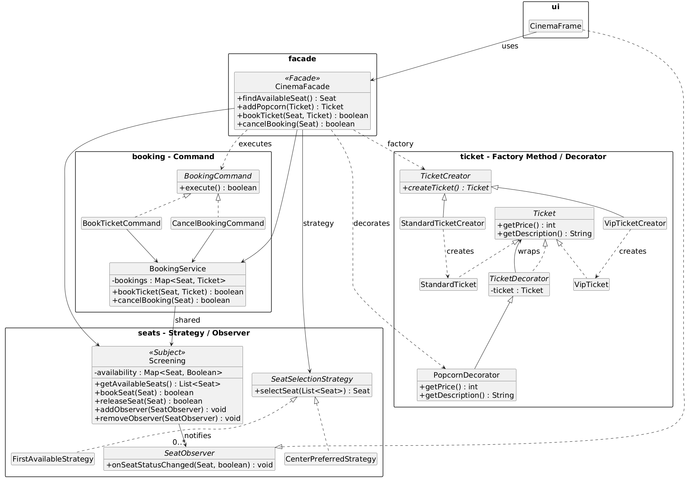
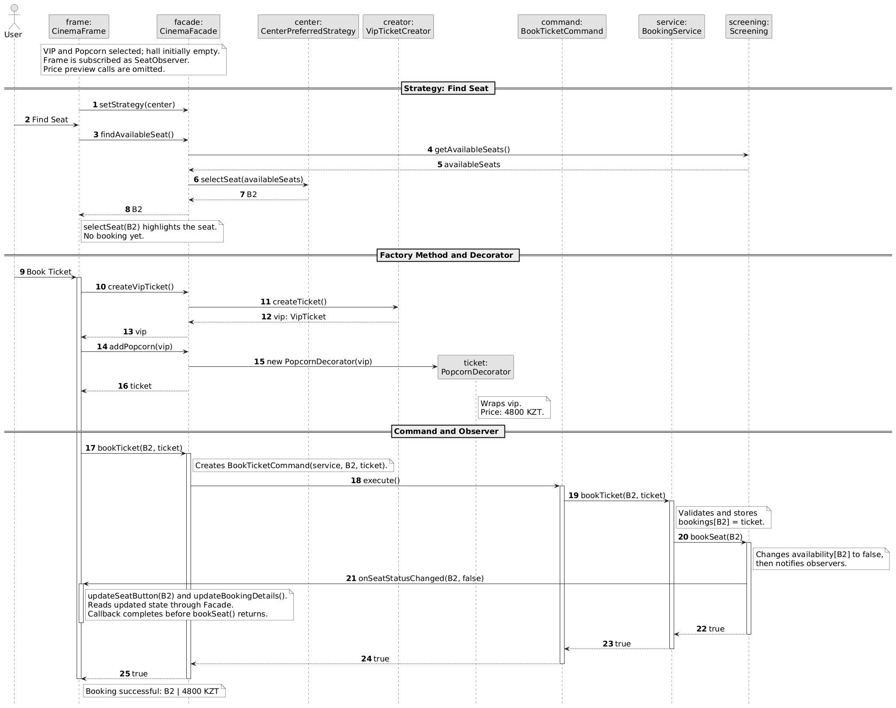

# Cinema Ticket Booking System

## Project Overview

Cinema Ticket Booking System is a small desktop application built with Java 17,
Maven and Swing. It uses six design patterns in one booking workflow: Factory
Method, Decorator, Strategy, Observer, Command and Facade.

The application shows one movie, Cinema Demo Movie, and 12 seats in rows A-C,
with four seats in each row.

## Features

- Standard tickets for 2000 KZT and VIP tickets for 4000 KZT.
- Optional Popcorn for an additional 800 KZT.
- Ticket price updates when the ticket type or Popcorn option changes.
- Manual seat selection or a suggestion from First Available or Center Preferred.
- Booking and cancellation, with protection against booking an occupied seat.
- Seat availability notifications that update the seat buttons.
- Details of the ticket booked for the selected seat.

First Available uses the order A1-A4, B1-B4, C1-C4. Center Preferred chooses the
nearest free seat to the center of the hall. It chooses B2 before B3 when both are
free. Equal distances are resolved by the seat order. Find Seat only selects a
seat; Book Ticket makes the booking.

## Design Patterns

| Pattern | Main Classes | Purpose |
|---|---|---|
| Factory Method | `Ticket`, `TicketCreator`, `StandardTicketCreator`, `VipTicketCreator`, `StandardTicket`, `VipTicket` | Create Standard and VIP tickets through concrete creators. |
| Decorator | `TicketDecorator`, `PopcornDecorator` | Wrap a ticket to add Popcorn to its price and description. |
| Strategy | `SeatSelectionStrategy`, `FirstAvailableStrategy`, `CenterPreferredStrategy` | Change the seat selection algorithm without changing booking logic. |
| Observer | `SeatObserver`, `Screening`, `CinemaFrame` | Notify the window after a successful seat availability change. |
| Command | `BookingCommand`, `BookTicketCommand`, `CancelBookingCommand`, `BookingService` | Represent booking and cancellation as executable requests. |
| Facade | `CinemaFacade` | Give the window a simple API for the connected subsystems. |

## Project Structure

Production code is in `src/main/java`:

| Package / Entry Point | Responsibility |
|---|---|
| `model` | Immutable seat coordinates and identifiers. |
| `ticket` | Ticket types, Factory Method and Decorator. |
| `seats` | Seat availability, Strategy and Observer. |
| `booking` | Active bookings and Command implementations. |
| `facade` | The public API used by the window. |
| `ui` | The single Swing window. |
| `Main.java` | Starts the window on the Swing Event Dispatch Thread. |

JUnit tests are in `src/test/java`. UML images are in `docs/uml`.

## UML Diagrams

Class Diagram: the six patterns and their relationships.



Sequence Diagram: a successful VIP booking with Popcorn.



The diagrams omit routine Swing details to keep the main workflow clear.

## Build and Run

Use JDK 17 and IntelliJ IDEA with Maven support. The project already contains a
JUnit 5 dependency and the Maven Compiler and Surefire plugins.

1. Open the project folder or `pom.xml` in IntelliJ IDEA as a Maven project.
2. Set the Project SDK and Maven runner JRE to Java 17.
3. Reload the Maven project to load its dependencies.
4. Open the Maven tool window and run **Lifecycle > test** to compile and run tests.
5. Open `src/main/java/Main.java` and run `Main.main()` to start the application.

If Maven is available in PowerShell, these commands also work from the project root:

```powershell
mvn clean test
java -cp target/classes Main
```

Closing the window exits the application. A graphical desktop is needed to run it.

## Testing

| Test Class | Tests | Coverage |
|---|---:|---|
| `TicketPatternsTest` | 4 | Ticket types, prices, descriptions and Popcorn decoration. |
| `SeatPatternsTest` | 8 | Initial availability, both strategies, booking/release and observer subscriptions. |
| `BookingFlowTest` | 9 | Facade booking flow, cancellation, duplicate booking, strategy switching, observer events, direct commands and a full hall. |

The complete suite contains 21 JUnit 5 tests. Run **Maven > Lifecycle > test** in
IntelliJ IDEA, or `mvn clean test` when Maven is available in your terminal.
These tests check business logic; they do not automate Swing interactions.

## Limitations

- One movie.
- One screening with 12 seats.
- In-memory data: bookings are reset when the application restarts.
